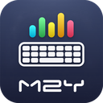

<p align="center"></p>
<h1 align="center">M2Y Tools</h1>
<p align="center"><b>Keyboard and equalizer in one lean app for the BYD multimedia screen</b><br><sub>BYD multimedya ekranı için klavye ve ekolayzır tek, hafif uygulamada · Клавиатура и эквалайзер в одном лёгком приложении для мультимедийного экрана BYD</sub></p>
<p align="center">
  <a href="https://github.com/mehmetmesut/byd-m2y-tools/releases/latest"></a>
  <a href="https://github.com/mehmetmesut/byd-m2y-tools/releases"></a>
  
  
  
  
</p>
<p align="center">
  <a href="https://github.com/mehmetmesut/byd-m2y-tools/releases/download/1.25.07.68.2/M2YTools_1.25.07.68.2.apk"><b>⬇ Download APK (6.2 MB)</b></a> ·
  <a href="https://byd.mehmetmesut.com">byd.mehmetmesut.com</a> ·
  <a href="https://github.com/mehmetmesut/byd-m2y">⭐ All M2Y apps for BYD</a>
</p>
<p align="center"> </p>
<details open>
<summary><b>🇬🇧 English</b></summary>

### Why this app

**M2Y Tools** brings the **M2Y Board** keyboard and the **M2Y EQ** equalizer together in one app: one icon, one background process, one Auto-start entry. Open it and choose **Ekolayzır** or **Klavye** at the top. Both parts were written for the same car and share the same rules: no ads, no tracking, as little CPU, RAM and storage as possible.

I built M2Y Board first for **my own BYD SEAL U DM-i** because the store apps did not fit the car: ads, Google Play dependencies, phone and TV layouts, and a heavy load on the CPU. The stock keyboard of DiLink 3.0 is built around Chinese input, and most keyboards from the stores need Google services or send what you type online. Then I made the app installable and usable on **BYD multimedia screens (DiLink)** and share it **free, without ads, without tracking**. It is built to use **as little of the head unit's CPU, RAM and storage as possible**: fast to open, smooth to touch, stable.

### Highlights

- **One app instead of two** – keyboard and equalizer run in one process with one icon; the separate M2Y Board and M2Y EQ apps are replaced.
- **Turkish Q out of the box** – enabled and selected on a fresh install whatever the system language is; Russian (Cyrillic) layout and dictionary are bundled too.
- **100 % offline** – no internet permission, nothing is backed up, no learning: what you type is never stored.
- **Compact, centred keyboard** – uses the middle 55 % of the 1920×1080 screen; the sides stay transparent and touches there go to the app below.
- **Your own words one tap away** – a toolbar key adds the selected text or the word before the cursor (name, e-mail…) to the personal dictionary.
- **Small** – 6.2 MB APK, arm64 native libraries only.
- **No settings to fiddle with** – only languages, personal dictionary and about remain; everything else is fixed to tuned values.
- **25 bands that you can really hear.** Bands are aligned to the audio engine's real FFT bins, so moving a slider changes the sound instead of a number.
- **Tuned for this cabin.** Presets are written for the Infinity system in a closed SUV cabin (boot subwoofer, door woofers, centre speaker, tweeters).
- **One effect, whole system.** A single `DynamicsProcessing` instance on the global output mix, so every app that plays sound is equalized.
- **Fair A/B.** An equal-level mode and a Reference switch let you judge a preset without the "louder sounds better" trap.
- **Stays out of calls.** During phone, VoIP and CarPlay calls the effect removes itself, so the hands-free echo canceller sees the plain signal.

### Keyboard

- Turkish Q layout (ı, ğ, ü, ş, ö, ç, ₺) with Turkish dictionary and suggestions (about 1.2 MB dictionary).
- Russian (Cyrillic) layout with Russian dictionary (about 2.2 MB); switch it on in *Languages & layouts*.
- Number row always on; keyboard height 82 % of the default; equal gaps (half a key gap) around the outer keys.
- Bottom row: `?123` · `@` · space · `.` · action · hide keyboard. Long-press `.` for punctuation (comma is pre-selected, `*` is in the list).
- `?123` opens symbols, number pad and emoji as three tabs (`?123` · `#+=` · 😀) on their bottom row.
- E-mail domain suggestions after `@` (gmail.com, hotmail.com, outlook.com, icloud.com, yahoo.com, yandex.com).
- Personal dictionary with shortcuts for fixed words such as your name or e-mail; add words from the toolbar or in the settings.
- Toolbar: expand key with settings, clipboard, emoji, undo, redo, select word, copy, paste and cursor keys; add-word and clipboard keys are always visible next to the suggestions; swipe down on the toolbar to hide the keyboard.
- Clipboard history kept 10 minutes, pinned clips first; image and file copies are not written to disk.
- Next-word suggestions and fixed punctuation suggestions (`-` `@` `_`) on an empty strip.
- Removed to save resources and protect privacy: autocorrect, learning from typing, spell checker service, gesture typing and gesture-data collection, key sound and vibration, themes, one-handed and floating modes, in-app log and crash reports.

### Equalizer

- **10 or 25 bands**, ±12 dB per band, aligned to the engine's real FFT bins (20 ms frames, 46.9 Hz bins at 48 kHz: one band per bin up to 281 Hz, 1/3 octave above), so every band is audible. Colour gradient (green → orange → red for boost, light blue → grey → purple for cut) and a ±6 dB safe-range guide; values beyond the safe range are shown in orange.
- **Presets:** M2Y (your own, editable), BYD (reference, flat), AI (gentle ±1.5 dB cabin correction), Pop, Rock, Rap, Classical, Speech. The presets avoid boosting 250–315 Hz (door-panel boxiness) and keep 4–5 kHz within +0.5 dB (A-pillar tweeters and windscreen glare).
- **Save to M2Y** keeps every setting (bands, bass, loudness, bass frequency, balance, surround, sound strength, intensity) and lights up only when something changed; **↺** returns M2Y to its factory values.
- **Sound strength:** Clean (preamp = largest boost + 2 dB, quietest), Balanced (default: the first 3 dB of boost pass) or Strong (no preamp, as loud as other EQ apps). There is **no limiter**: as in other EQ apps, very loud peaks can clip.
- **Preset intensity** 0–200 % scales the curve; **bass and loudness up to +15 dB**.
- **Fair comparison:** equal-level mode takes back the curve's average gain (90 Hz – 8 kHz) so presets can be judged without the louder-sounds-better trap.
- **Sound tab:** bass frequency (40–150 Hz, default 80 Hz; 60–90 Hz recommended for the subwoofer), left/right balance, optional virtual surround (the effect is only created when switched on, and dropped again if the output does not support it).
- **Hi-Fi DSP / Reference switch:** Reference removes every effect from the audio path for a true A/B; the factory Infinity chain then receives the stream untouched.
- **Call handling:** during phone, VoIP and CarPlay calls the EQ steps aside and returns when the call ends. The call state is also polled every 2 seconds because Android 10 has no audio-mode listener and modem or Bluetooth hands-free calls raise no playback event. The wake-word and voice-assistant capture is deliberately ignored, otherwise music would stay unprocessed most of the time.
- **Short fades** (about 40 ms) on preset changes, so there are no clicks.
- **Crash-safe engine:** if the audio server restarts or an effect is lost, the broken instance is dropped and rebuilt on the next apply instead of crash-looping the boot-time service. All effect work runs on one background thread.
- **Player integration:** music players can open M2Y Tools from their own "equalizer" button (`DISPLAY_AUDIO_EFFECT_CONTROL_PANEL`). If the platform ever refuses the global mix, the service follows individual player sessions instead.
- **Runs after reboot** through a foreground service with a minimum-importance notification that shows the current state; settings are re-applied after boot and after an app update.

### Built for the head unit

| Head unit fact | Design decision |
|---|---|
| Android 10 (API 29), arm64-v8a, no Google services | No Google or Play dependency, no internet permission; the release APK carries arm64 native libraries only (6.2 MB) |
| 1920×1080 landscape touch screen, 240 dpi | Keyboard centred in 55 % of the width, transparent sides, height 82 %, number row always on |
| Turkish owner, occasional Russian | **Turkish Q** is enabled and selected on a fresh install regardless of the system language; Russian layout and dictionary bundled |
| Qualcomm SM6125, must never stutter | No learning, autocorrect, spell checker, gesture typing, key sound or vibration; emoji suggestions off; no clipboard file copies |
| Copy and paste while parked | Clipboard and add-word keys always visible on the toolbar |
| No voice input service | No microphone key |
| Privacy and a quiet settings screen | No data collection, no logs on disk; settings reduced to languages, personal dictionary and about |
| Infinity system, 10 speakers including a boot subwoofer, SUV cabin | Presets measured against this cabin; bass shelf 40–150 Hz (60–90 Hz recommended for the subwoofer) |
| Qualcomm SM6125, must never stutter | One `DynamicsProcessing` instance on the global mix (session 0); only parameters change, effects are never rebuilt; work on a background thread |
| Android 10 `DynamicsProcessing` works on FFT bins (46.9 Hz at 48 kHz with 20 ms frames) | 25 bands aligned to those bins, so every band owns at least one bin; about 21 ms latency at the same CPU cost |
| Hands-free calls through the car | During phone, VoIP and CarPlay calls the effect removes itself, so the echo canceller sees the plain signal |
| Audio server can restart or change route | Lost effects are detected and rebuilt on the next apply; no crash loop at boot |
| 1920×1080 landscape, 240 dpi touch screen | 56 dp touch targets, large numerals, day and night themes, forced landscape |

### Install

M2Y Tools replaces M2Y Board and M2Y EQ. Remove those first (their settings are not carried over; the equalizer starts with the factory M2Y preset), then install on a head unit with wireless ADB enabled:

```
adb connect <car-ip>:5555
adb uninstall com.m2y.board
adb uninstall com.m2y.eq
adb install -r M2YTools_1.25.07.68.2.apk
adb shell ime enable com.m2y.tools/helium314.keyboard.latin.LatinIME
adb shell ime set com.m2y.tools/helium314.keyboard.latin.LatinIME
```

Open M2Y Tools once so the equalizer starts, and allow it under DiLink's **Auto-start** so it comes back after every boot. Instead of the two `ime` commands you can open **Klavye** in M2Y Tools: the keyboard setup wizard appears while the keyboard is not enabled yet.

- **Windows one-click installer:** https://byd.mehmetmesut.com/m2y-kurulum.cmd – asks for the car's IP, downloads Google's platform-tools if missing, downloads the chosen apps, verifies SHA-256 and installs.
- **Direct install from the car's browser** only works on head units whose **stock BYD package installer has been unlocked** (the stock one blocks third-party APKs with a "driving safety" notice). This project does not distribute BYD files.
- All M2Y APKs are signed with the same M2Y key, so updates install over the previous version and keep your settings.
- After installing, the SealNav / stock launcher may need a restart to show the new icon.
- SHA-256 sums are listed at https://byd.mehmetmesut.com.

### Privacy & permissions

The app has **no internet permission** and `allowBackup` is off, so typed words and the clipboard history never leave the device and are not part of any backup. The manifest declares:

| Permission | Why |
|---|---|
| `MODIFY_AUDIO_SETTINGS` | Create and control the audio effects (equalizer, optional virtual surround) |
| `FOREGROUND_SERVICE` | Keep the equalizer service alive while the car is on; it shows one low-priority notification |
| `READ_USER_DICTIONARY` / `WRITE_USER_DICTIONARY` | Read and write the system user dictionary (your own saved words) |
| `RECEIVE_BOOT_COMPLETED` | Re-applies the equalizer and prepares the keyboard after boot and after an app update |
| `VIBRATE` | Declared by the upstream keyboard; key vibration is **off** and has no setting |

Never collected: no analytics, no crash reporting, no advertising, no tracking, no gesture data, no account.

### Compatibility

Designed and tested on the BYD SEAL U DM-i (DiLink 3.0). Other BYD models with an Android 10+ arm64 multimedia screen are expected to work but are not tested.

Target head unit: BYD DiLink 3.0 · Android 10 (API 29) · no Google services · Qualcomm SM6125 (8 cores, 4×1.8 + 4×2.0 GHz), Adreno 610 · 8 GB RAM · arm64-v8a · 1920×1080 landscape touch screen, 240 dpi, 60 Hz.

### Build from source

Requirements: JDK 17 or newer (CI uses 17), Android SDK (compileSdk 37), NDK 28.0.13004108.

```
./gradlew assembleRelease
```

The signed APK lands in `app/build/outputs/apk/release/`. Signing reads a properties file outside the repository (`m2y.signingProps` in `local.properties`). Release builds contain only the arm64-v8a libraries; debug builds also include x86_64 for emulator testing.

### Closing words

I made M2Y Board because typing in my own BYD SEAL U DM-i should be as comfortable as on a phone, without ads, without tracking and without asking the head unit for more than it can spare. If it makes your car a little nicer to use, I am glad. Questions and ideas are welcome as issues. If you like the project, please leave a ⭐ on the [hub repository](https://github.com/mehmetmesut/byd-m2y).

– **Yeşil Dönüşüm Mühendisi - M2Y**

</details>

<details>
<summary><b>🇹🇷 Türkçe</b></summary>

### Neden bu uygulama

**M2Y Tools**, **M2Y Board** klavyesini ve **M2Y EQ** ekolayzırını tek uygulamada toplar: tek simge, tek arka plan süreci, tek Otomatik Başlatma kaydı. Açınca üstten **Ekolayzır** ya da **Klavye**'yi seçin. İki bölüm de aynı araç için yazıldı ve aynı kurallara uyar: reklam yok, izleme yok, olabildiğince az işlemci, RAM ve depolama.

M2Y Board'u önce **kendi BYD SEAL U DM-i aracım** için yaptım; çünkü mağaza uygulamaları araca uymuyordu: reklamlar, Google Play bağımlılıkları, telefon ve TV arayüzleri, işlemciyi yoran ağır yapı. DiLink 3.0'ın kendi klavyesi Çince girişe göre tasarlanmış, mağazadaki klavyelerin çoğu da Google hizmeti istiyor ya da yazdıklarınızı çevrimiçi gönderiyor. Sonra uygulamayı **BYD multimedya ekranlarında (DiLink)** kurulup kullanılabilir hâle getirdim ve **ücretsiz, reklamsız, izlemesiz** paylaşıyorum. Başlıca hedef, **başlık ünitesinin işlemcisini, RAM'ini ve depolamasını olabildiğince az kullanmak**: hızlı açılır, dokunuşa akıcı yanıt verir, kararlı çalışır.

### Öne çıkanlar

- **İki uygulama yerine bir** – klavye ve ekolayzır tek süreçte, tek simgeyle çalışır; ayrı M2Y Board ve M2Y EQ uygulamalarının yerini alır.
- **Kutudan çıktığı gibi Türkçe Q** – temiz kurulumda sistem dili ne olursa olsun açık ve seçili; Rusça (Kiril) düzen ve sözlük de pakette hazır.
- **%100 çevrim dışı** – internet izni yok, hiçbir şey yedeklenmez, öğrenme yok: yazdıklarınız hiçbir yerde saklanmaz.
- **Ortada, derli toplu klavye** – 1920×1080 ekranın ortadaki %55'ini kullanır; yanlar şeffaftır, oraya dokunuş alttaki uygulamaya gider.
- **Kendi kelimeleriniz tek dokunuşta** – araç çubuğundaki tuş seçili metni ya da imlecin solundaki kelimeyi (ad, e-posta…) kişisel sözlüğe ekler.
- **Küçük** – 6,2 MB APK, yalnızca arm64 yerel kitaplıkları.
- **Uğraştıran ayar yok** – yalnız diller, kişisel sözlük ve hakkında kaldı; geri kalan her şey ayarlanmış değerlerde sabit.
- **Gerçekten duyulan 25 bant.** Bantlar ses motorunun gerçek FFT kutularına hizalıdır; kaydırıcıyı oynattığınızda yalnız bir sayı değil, ses de değişir.
- **Bu kabine göre ayarlı.** Ön ayarlar, kapalı bir SUV kabininde Infinity sistemi (bagaj subwoofer'ı, kapı woofer'ları, orta hoparlör, tweeter'lar) için yazıldı.
- **Tek efekt, tüm sistem.** Genel çıkış karışımında tek bir `DynamicsProcessing` örneği çalışır; ses çalan her uygulama ekolayzırdan geçer.
- **Adil A/B.** Eşit ses düzeyi modu ve Referans anahtarı, "yüksek olan iyi gelir" yanılgısına düşmeden ön ayar karşılaştırmanızı sağlar.
- **Görüşmeye karışmaz.** Telefon, VoIP ve CarPlay görüşmelerinde efekt kendini kaldırır; ahizesiz eko giderici düz sinyali görür.

### Klavye

- Türkçe Q düzeni (ı, ğ, ü, ş, ö, ç, ₺), Türkçe sözlük ve öneriler (sözlük yaklaşık 1,2 MB).
- Rusça (Kiril) düzen ve Rusça sözlük (yaklaşık 2,2 MB); *Diller ve Düzenler*'den açılır.
- Rakam satırı her zaman açık; klavye yüksekliği varsayılanın %82'si; dıştaki tuşların çevresinde eşit boşluk (tuş arası boşluğun yarısı).
- Alt satır: `?123` · `@` · boşluk · `.` · eylem · klavyeyi gizle. `.` tuşuna uzun basınca noktalama listesi (virgül hazır seçili, `*` listede).
- `?123` sembolleri, sayı tuş takımını ve emojiyi alt satırlarında üç sekme olarak açar (`?123` · `#+=` · 😀).
- `@` sonrasında e-posta alan adı önerileri (gmail.com, hotmail.com, outlook.com, icloud.com, yahoo.com, yandex.com).
- Adınız, e-postanız gibi sabit bilgiler için kısayollu kişisel sözlük; kelimeyi araç çubuğundan ya da ayarlardan ekleyin.
- Araç çubuğu: açma tuşunda ayarlar, pano, emoji, geri al, yinele, kelime seç, kopyala, yapıştır ve imleç tuşları; kelime ekle ve pano tuşları önerilerin yanında hep görünür; araç çubuğunda aşağı kaydırınca klavye gizlenir.
- Pano geçmişi 10 dakika tutulur, sabitlenenler önde; görsel ve dosya kopyaları diske yazılmaz.
- Sonraki kelime önerileri ve boş şeritte sabit noktalama önerileri (`-` `@` `_`).
- Kaynak ve gizlilik için kaldırılanlar: otomatik düzeltme, yazdıklarından öğrenme, yazım denetimi hizmeti, kaydırarak yazma ve hareket verisi toplama, tuş sesi ve titreşim, temalar, tek el ve yüzen klavye, uygulama içi günlük ve çökme raporları.

### Ekolayzır

- **10 veya 25 bant**, bant başına ±12 dB; bantlar motorun gerçek FFT kutularına hizalıdır (20 ms çerçeve, 48 kHz'de 46,9 Hz'lik kutular: 281 Hz'e kadar kutu başına bir bant, üstünde 1/3 oktav), böylece her bant duyulur. Renk gradyanı (yükseltme için yeşil → turuncu → kırmızı, kısma için açık mavi → gri → mor) ve ±6 dB güvenli aralık kılavuzu; güvenli aralığın dışındaki değerler turuncu gösterilir.
- **Ön ayarlar:** M2Y (kendi ayarınız, düzenlenebilir), BYD (referans, düz), AI (hafif ±1,5 dB kabin düzeltmesi), Pop, Rock, Rap, Klasik, Konuşma. Ön ayarlar 250–315 Hz'i yükseltmez (kapı panelinin çınlaması) ve 4–5 kHz'i +0,5 dB içinde tutar (A sütunundaki tweeter'lar ve ön cam parlaması).
- **M2Y'ye kaydet** tüm ayarları saklar (bantlar, bas, ses yükseltme, bas frekansı, denge, surround, ses gücü, yoğunluk) ve yalnız bir değişiklik varken etkinleşir; **↺** M2Y'yi fabrika değerlerine döndürür.
- **Ses gücü:** Temiz (ön kazanç = en büyük yükseltme + 2 dB, en sessiz), Dengeli (varsayılan: yükseltmenin ilk 3 dB'si geçer) veya Güçlü (ön kazanç yok, diğer EQ uygulamaları kadar yüksek). **Sınırlayıcı yoktur:** diğer EQ uygulamalarında olduğu gibi çok yüksek tepeler kırpılabilir.
- **Ön ayar yoğunluğu** %0–200 eğriyi ölçekler; **bas ve ses yükseltme +15 dB'e kadar**.
- **Adil karşılaştırma:** eşit ses düzeyi modu eğrinin ortalama kazancını (90 Hz – 8 kHz) geri alır; ön ayarlar "yüksek olan iyi gelir" yanılgısı olmadan karşılaştırılır.
- **Ses sekmesi:** bas frekansı (40–150 Hz, varsayılan 80 Hz; subwoofer için 60–90 Hz önerilir), sol/sağ denge, isteğe bağlı sanal surround (efekt yalnız açıldığında oluşturulur; çıkış desteklemiyorsa yeniden bırakılır).
- **Hi-Fi DSP / Referans anahtarı:** Referans, ses yolundan her efekti kaldırır, gerçek bir A/B sağlar; fabrika Infinity zinciri akışı değişmeden alır.
- **Görüşme yönetimi:** telefon, VoIP ve CarPlay görüşmelerinde EQ kenara çekilir, görüşme bitince geri döner. Android 10'da ses modu dinleyicisi olmadığından ve modem ya da Bluetooth ahizesiz görüşmeler oynatma olayı üretmediğinden görüşme durumu 2 saniyede bir de yoklanır. Uyandırma sözcüğü ve sesli asistan yakalaması bilerek yok sayılır; yoksa müzik çoğu zaman işlenmeden kalırdı.
- **Kısa geçişler** (yaklaşık 40 ms): ön ayar değişince tıkırtı olmaz.
- **Çökmeye dayanıklı motor:** ses sunucusu yeniden başlarsa ya da bir efekt kaybolursa bozuk örnek bırakılır ve sonraki uygulamada yeniden kurulur; açılışta çalışan servis çökme döngüsüne girmez. Tüm efekt işleri tek bir arka plan iş parçacığında yürür.
- **Oynatıcı bütünleşmesi:** müzik oynatıcıları kendi "ekolayzır" düğmesinden M2Y Tools'yu açabilir (`DISPLAY_AUDIO_EFFECT_CONTROL_PANEL`). Platform genel karışımı reddederse servis tek tek oynatıcı oturumlarını izler.
- **Yeniden başlatmadan sonra çalışır:** durumu gösteren, en düşük önemde bir bildirimi olan ön plan servisi sayesinde; ayarlar açılışta ve uygulama güncellemesinden sonra yeniden uygulanır.

### Başlık ünitesi için tasarım

| Başlık ünitesi gerçeği | Tasarım kararı |
|---|---|
| Android 10 (API 29), arm64-v8a, Google hizmeti yok | Google ya da Play bağımlılığı yok, internet izni yok; sürüm APK'sı yalnızca arm64 yerel kitaplıkları içerir (6,2 MB) |
| 1920×1080 yatay dokunmatik ekran, 240 dpi | Klavye genişliğin %55'inde ortalı, yanlar şeffaf, yükseklik %82, rakam satırı her zaman açık |
| Türkçe konuşan sahip, ara sıra Rusça | **Türkçe Q** temiz kurulumda sistem dilinden bağımsız olarak açık ve seçili; Rusça düzen ve sözlük pakette |
| Qualcomm SM6125, asla takılmamalı | Öğrenme, otomatik düzeltme, yazım denetimi, kaydırarak yazma, tuş sesi ve titreşim yok; emoji önerisi kapalı; pano dosya kopyası yok |
| Park hâlinde kopyala-yapıştır | Pano ve kelime ekle tuşları araç çubuğunda her zaman görünür |
| Sesli giriş hizmeti yok | Mikrofon tuşu yok |
| Gizlilik ve sakin bir ayar ekranı | Veri toplama yok, diske günlük yok; ayarlar diller, kişisel sözlük ve hakkında ile sınırlı |
| Infinity sistemi, bagaj subwoofer'ı dahil 10 hoparlör, SUV kabini | Ön ayarlar bu kabine göre ölçüldü; bas rafı 40–150 Hz (subwoofer için 60–90 Hz önerilir) |
| Qualcomm SM6125, asla takılmamalı | Genel karışımda (oturum 0) tek `DynamicsProcessing` örneği; yalnız parametreler değişir, efektler yeniden kurulmaz; iş arka plan iş parçacığında |
| Android 10 `DynamicsProcessing` FFT kutularıyla çalışır (20 ms çerçevede 48 kHz'de 46,9 Hz) | 25 bant bu kutulara hizalı, her bant en az bir kutuya sahip; aynı işlemci maliyetiyle yaklaşık 21 ms gecikme |
| Araç üzerinden ahizesiz görüşme | Telefon, VoIP ve CarPlay görüşmelerinde efekt kendini kaldırır; eko giderici düz sinyali görür |
| Ses sunucusu yeniden başlayabilir ya da yol değiştirebilir | Kaybolan efektler algılanır ve sonraki uygulamada yeniden kurulur; açılışta çökme döngüsü yok |
| 1920×1080 yatay, 240 dpi dokunmatik ekran | 56 dp dokunma hedefleri, büyük rakamlar, gündüz ve gece temaları, zorunlu yatay yön |

### Kurulum

M2Y Tools, M2Y Board ve M2Y EQ'nun yerini alır. Önce onları kaldırın (ayarları taşınmaz; ekolayzır fabrika M2Y ön ayarıyla başlar), sonra kablosuz ADB'nin açık olduğu başlık ünitesine kurun:

```
adb connect <araç-ip>:5555
adb uninstall com.m2y.board
adb uninstall com.m2y.eq
adb install -r M2YTools_1.25.07.68.2.apk
adb shell ime enable com.m2y.tools/helium314.keyboard.latin.LatinIME
adb shell ime set com.m2y.tools/helium314.keyboard.latin.LatinIME
```

Ekolayzırın başlaması için M2Y Tools'u bir kez açın ve her açılışta geri gelmesi için DiLink'in **Otomatik Başlatma** listesinde izin verin. İki `ime` komutu yerine M2Y Tools'ta **Klavye**'yi açabilirsiniz: klavye henüz etkin değilse kurulum sihirbazı çıkar.

- **Windows tek tıkla kurulum:** https://byd.mehmetmesut.com/m2y-kurulum.cmd – aracın IP adresini sorar, yoksa Google'ın platform-tools paketini indirir, seçilen uygulamaları indirir, SHA-256'yı doğrular ve kurar.
- **Aracın tarayıcısından doğrudan kurulum** yalnızca **özgün BYD paket yükleyicisinin kilidi açılmış** başlık ünitelerinde çalışır (özgün yükleyici üçüncü taraf APK'leri «sürüş güvenliği» uyarısıyla engeller). Bu proje BYD dosyası dağıtmaz.
- Tüm M2Y APK'leri aynı M2Y anahtarıyla imzalıdır; güncellemeler önceki sürümün üzerine kurulur ve ayarlarınız korunur.
- Kurulumdan sonra yeni simgenin görünmesi için SealNav / özgün başlatıcının yeniden başlatılması gerekebilir.
- SHA-256 toplamları https://byd.mehmetmesut.com adresinde listelenir.

### Gizlilik ve izinler

Uygulamada **internet izni yoktur** ve `allowBackup` kapalıdır; yazdığınız sözcükler ve pano geçmişi cihazdan çıkmaz, hiçbir yedeğe dâhil olmaz. Manifest şu izinleri bildirir:

| İzin | Neden |
|---|---|
| `MODIFY_AUDIO_SETTINGS` | Ses efektlerini (ekolayzır, isteğe bağlı sanal surround) kurmak ve yönetmek |
| `FOREGROUND_SERVICE` | Araç açıkken ekolayzır servisini çalışır tutmak; düşük öncelikli tek bir bildirim gösterir |
| `READ_USER_DICTIONARY` / `WRITE_USER_DICTIONARY` | Sistem kullanıcı sözlüğünü (kendi kaydettiğiniz sözcükleri) okumak ve yazmak |
| `RECEIVE_BOOT_COMPLETED` | Açılıştan ve uygulama güncellemesinden sonra ekolayzırı yeniden uygular, klavyeyi hazırlar |
| `VIBRATE` | Üst projeden kalan bildirim; tuş titreşimi **kapalıdır** ve ayarı yoktur |

Hiçbir zaman toplanmaz: analitik, çökme raporu, reklam, izleme, hareket verisi ve hesap yoktur.

### Uyumluluk

BYD SEAL U DM-i (DiLink 3.0) üzerinde tasarlandı ve denendi. Android 10+ arm64 multimedya ekranlı diğer BYD modellerinde de çalışması beklenir, ancak denenmemiştir.

Hedef başlık ünitesi: BYD DiLink 3.0 · Android 10 (API 29) · Google hizmeti yok · Qualcomm SM6125 (8 çekirdek, 4×1,8 + 4×2,0 GHz), Adreno 610 · 8 GB RAM · arm64-v8a · 1920×1080 yatay dokunmatik ekran, 240 dpi, 60 Hz.

### Kaynaktan derleme

Gereksinimler: JDK 17 veya üzeri (CI 17 kullanır), Android SDK (compileSdk 37), NDK 28.0.13004108.

```
./gradlew assembleRelease
```

İmzalı APK `app/build/outputs/apk/release/` klasörüne çıkar. İmzalama, depo dışındaki bir özellik dosyasını okur (`local.properties` içindeki `m2y.signingProps`). Sürüm derlemeleri yalnızca arm64-v8a kitaplıklarını içerir; hata ayıklama derlemelerine emülatör denemesi için x86_64 de eklenir.

### Kapanış

M2Y Board'u, kendi BYD SEAL U DM-i aracımda yazı yazmak telefondaki kadar rahat olsun; reklam, izleme ve başlık ünitesinden gücünün fazlasını istemek olmasın diye yaptım. Aracınızı kullanmayı biraz daha keyifli kılarsa ne mutlu bana. Soru ve fikirlerinizi issue olarak iletebilirsiniz. Proje hoşunuza gittiyse [merkez depoya](https://github.com/mehmetmesut/byd-m2y) bir ⭐ bırakmanız beni çok sevindirir.

– **Yeşil Dönüşüm Mühendisi - M2Y**

</details>

<details>
<summary><b>🇷🇺 Русский</b></summary>

### Зачем это приложение

**M2Y Tools** объединяет клавиатуру **M2Y Board** и эквалайзер **M2Y EQ** в одном приложении: один значок, один фоновый процесс, одна запись в автозапуске. Откройте его и выберите вверху **Ekolayzır** или **Klavye**. Обе части написаны для одного автомобиля и следуют одним правилам: без рекламы, без слежки, как можно меньше нагрузки на процессор, ОЗУ и память.

M2Y Board я сделал сначала для **собственного BYD SEAL U DM-i**, потому что приложения из магазинов не подходили автомобилю: реклама, зависимость от Google Play, интерфейсы для телефона и ТВ, большая нагрузка на процессор. Штатная клавиатура DiLink 3.0 рассчитана на ввод китайского текста, а большинство клавиатур из магазинов требуют сервисы Google или отправляют набранное в сеть. Затем я сделал приложение пригодным для установки и работы на **мультимедийных экранах BYD (DiLink)** и раздаю его **бесплатно, без рекламы, без слежки**. Главная цель — **как можно меньше загружать процессор, ОЗУ и память головного устройства**: быстрый запуск, плавный отклик на касания, стабильная работа.

### Главное

- **Одно приложение вместо двух** – клавиатура и эквалайзер работают в одном процессе с одним значком и заменяют отдельные M2Y Board и M2Y EQ.
- **Турецкая раскладка Q из коробки** – при чистой установке включена и выбрана независимо от языка системы; русская (кириллическая) раскладка и словарь тоже входят в комплект.
- **100 % офлайн** – нет разрешения на интернет, ничего не попадает в резервные копии, нет обучения: набранный текст нигде не сохраняется.
- **Компактная клавиатура по центру** – занимает средние 55 % экрана 1920×1080; края прозрачные, касания там попадают в приложение под клавиатурой.
- **Свои слова в одно касание** – клавиша на панели добавляет выделенный текст или слово перед курсором (имя, e-mail…) в личный словарь.
- **Компактность** – APK 6,2 МБ, только нативные библиотеки arm64.
- **Никаких лишних настроек** – остались только языки, личный словарь и «О программе»; всё остальное зафиксировано на подобранных значениях.
- **25 полос, которые действительно слышно.** Полосы выровнены по реальным FFT-бинам аудиодвижка, поэтому ползунок меняет звук, а не только число.
- **Настроено под этот салон.** Пресеты написаны для системы Infinity в закрытом салоне внедорожника (сабвуфер в багажнике, дверные низкочастотные динамики, центральный динамик, твитеры).
- **Один эффект на всю систему.** Один экземпляр `DynamicsProcessing` на общем выходном микшере, поэтому эквализация действует на любое приложение со звуком.
- **Честное A/B-сравнение.** Режим равной громкости и переключатель «Референс» позволяют оценивать пресет без ловушки «громче значит лучше».
- **Не мешает разговорам.** Во время телефонных, VoIP- и CarPlay-звонков эффект сам отключается, и эхоподавитель громкой связи получает чистый сигнал.

### Клавиатура

- Турецкая раскладка Q (ı, ğ, ü, ş, ö, ç, ₺), турецкий словарь и подсказки (словарь около 1,2 МБ).
- Русская (кириллическая) раскладка и русский словарь (около 2,2 МБ); включается в разделе *Языки и раскладки*.
- Цифровой ряд всегда включён; высота клавиатуры 82 % от стандартной; одинаковые отступы (половина промежутка между клавишами) вокруг крайних клавиш.
- Нижний ряд: `?123` · `@` · пробел · `.` · действие · скрыть клавиатуру. Долгое нажатие на `.` — список знаков препинания (запятая выбрана сразу, `*` в списке).
- `?123` открывает символы, цифровую панель и эмодзи как три вкладки (`?123` · `#+=` · 😀) в их нижнем ряду.
- Подсказки доменов после `@` (gmail.com, hotmail.com, outlook.com, icloud.com, yahoo.com, yandex.com).
- Личный словарь с сокращениями для постоянных слов вроде имени или e-mail; слова добавляются с панели инструментов или в настройках.
- Панель инструментов: по кнопке раскрытия — настройки, буфер обмена, эмодзи, отмена, повтор, выделение слова, копирование, вставка и клавиши курсора; клавиши «добавить слово» и буфера всегда видны рядом с подсказками; свайп вниз по панели скрывает клавиатуру.
- История буфера обмена хранится 10 минут, закреплённые записи первыми; изображения и файлы на диск не записываются.
- Подсказки следующего слова и постоянные знаки препинания (`-` `@` `_`) на пустой строке подсказок.
- Удалено ради экономии ресурсов и конфиденциальности: автокоррекция, обучение на вводе, служба проверки орфографии, ввод жестами и сбор данных жестов, звук и вибрация клавиш, темы, режимы одной руки и плавающей клавиатуры, журнал в приложении и отчёты о сбоях.

### Эквалайзер

- **10 или 25 полос**, ±12 дБ на полосу; полосы выровнены по реальным FFT-бинам движка (кадры по 20 мс, бины по 46,9 Гц при 48 кГц: до 281 Гц одна полоса на бин, выше — 1/3 октавы), поэтому каждая полоса слышна. Цветовой градиент (подъём: зелёный → оранжевый → красный, срез: голубой → серый → фиолетовый) и ориентир безопасного диапазона ±6 дБ; значения за его пределами показываются оранжевым.
- **Пресеты:** M2Y (ваш собственный, редактируемый), BYD (референс, плоский), AI (мягкая коррекция салона ±1,5 дБ), Pop, Rock, Rap, «Классика», «Речь». Пресеты не поднимают 250–315 Гц (гулкость дверных панелей) и держат 4–5 кГц в пределах +0,5 дБ (твитеры в стойках А и блики от лобового стекла).
- **«Сохранить в M2Y»** запоминает все настройки (полосы, бас, громкость, частоту баса, баланс, окружение, силу звука, интенсивность) и подсвечивается только при наличии изменений; **↺** возвращает M2Y к заводским значениям.
- **Сила звука:** «Чистая» (предусиление = наибольший подъём + 2 дБ, тише всего), «Сбалансированная» (по умолчанию: первые 3 дБ подъёма проходят) или «Сильная» (без предусиления, так же громко, как другие эквалайзеры). **Ограничителя нет:** как и в других эквалайзерах, очень громкие пики могут срезаться.
- **Интенсивность пресета** 0–200 % масштабирует кривую; **бас и громкость до +15 дБ**.
- **Честное сравнение:** режим равной громкости возвращает средний прирост кривой (90 Гц – 8 кГц), поэтому пресеты можно сравнивать без ловушки «громче значит лучше».
- **Вкладка «Звук»:** частота баса (40–150 Гц, по умолчанию 80 Гц; для сабвуфера рекомендуется 60–90 Гц), баланс лево/право, необязательное виртуальное окружение (эффект создаётся только при включении и снова удаляется, если выход его не поддерживает).
- **Переключатель Hi-Fi DSP / «Референс»:** «Референс» убирает все эффекты из аудиотракта для настоящего A/B; заводская цепочка Infinity получает поток без изменений.
- **Обработка звонков:** во время телефонных, VoIP- и CarPlay-звонков эквалайзер отступает и возвращается после завершения звонка. Состояние звонка дополнительно опрашивается каждые 2 секунды: в Android 10 нет слушателя аудиорежима, а звонки громкой связи через модем или Bluetooth не порождают события воспроизведения. Захват слова активации и голосового ассистента намеренно игнорируется, иначе музыка большую часть времени оставалась бы необработанной.
- **Короткие плавные переходы** (около 40 мс) при смене пресета, без щелчков.
- **Устойчивый к сбоям движок:** если аудиосервер перезапустился или эффект потерян, повреждённый экземпляр отбрасывается и пересоздаётся при следующем применении, вместо цикла падений службы, запускаемой при загрузке. Вся работа с эффектами идёт в одном фоновом потоке.
- **Интеграция с плеерами:** музыкальные плееры могут открыть M2Y Tools собственной кнопкой «эквалайзер» (`DISPLAY_AUDIO_EFFECT_CONTROL_PANEL`). Если платформа откажет в общем микшере, служба переключается на сессии отдельных плееров.
- **Работает после перезагрузки:** через фоновую службу переднего плана с уведомлением минимальной важности, показывающим текущее состояние; настройки применяются заново после загрузки и после обновления приложения.

### Создано для головного устройства

| Особенность головного устройства | Решение |
|---|---|
| Android 10 (API 29), arm64-v8a, нет сервисов Google | Нет зависимостей от Google и Play, нет разрешения на интернет; релизный APK содержит только нативные библиотеки arm64 (6,2 МБ) |
| Горизонтальный сенсорный экран 1920×1080, 240 dpi | Клавиатура по центру на 55 % ширины, прозрачные края, высота 82 %, цифровой ряд всегда включён |
| Владелец говорит по-турецки, иногда по-русски | **Турецкая раскладка Q** включена и выбрана при чистой установке независимо от языка системы; русская раскладка и словарь в комплекте |
| Qualcomm SM6125, никаких подтормаживаний | Нет обучения, автокоррекции, проверки орфографии, ввода жестами, звука и вибрации клавиш; подсказки эмодзи выключены; нет файловых копий буфера |
| Копирование и вставка на стоянке | Клавиши буфера и «добавить слово» всегда видны на панели инструментов |
| Нет службы голосового ввода | Нет клавиши микрофона |
| Конфиденциальность и спокойный экран настроек | Никакого сбора данных, никаких журналов на диске; настройки сведены к языкам, личному словарю и «О программе» |
| Система Infinity, 10 динамиков, включая сабвуфер в багажнике, салон внедорожника | Пресеты выверены под этот салон; полка баса 40–150 Гц (для сабвуфера рекомендуется 60–90 Гц) |
| Qualcomm SM6125, никаких подтормаживаний | Один экземпляр `DynamicsProcessing` на общем микшере (сессия 0); меняются только параметры, эффекты не пересоздаются; работа в фоновом потоке |
| `DynamicsProcessing` в Android 10 работает с FFT-бинами (46,9 Гц при 48 кГц и кадрах 20 мс) | 25 полос выровнены по этим бинам, у каждой полосы не менее одного бина; задержка около 21 мс при той же нагрузке на процессор |
| Громкая связь через автомобиль | Во время телефонных, VoIP- и CarPlay-звонков эффект сам отключается, эхоподавитель получает чистый сигнал |
| Аудиосервер может перезапуститься или сменить маршрут | Потерянные эффекты обнаруживаются и пересоздаются при следующем применении; нет цикла падений при загрузке |
| Сенсорный экран 1920×1080, альбомный, 240 dpi | Цели касания 56 dp, крупные цифры, дневная и ночная темы, принудительная альбомная ориентация |

### Установка

M2Y Tools заменяет M2Y Board и M2Y EQ. Сначала удалите их (настройки не переносятся; эквалайзер начинает с заводской предустановки M2Y), затем установите на головное устройство с включённым беспроводным ADB:

```
adb connect <ip-автомобиля>:5555
adb uninstall com.m2y.board
adb uninstall com.m2y.eq
adb install -r M2YTools_1.25.07.68.2.apk
adb shell ime enable com.m2y.tools/helium314.keyboard.latin.LatinIME
adb shell ime set com.m2y.tools/helium314.keyboard.latin.LatinIME
```

Откройте M2Y Tools один раз, чтобы запустить эквалайзер, и разрешите его в **автозапуске** DiLink, чтобы он возвращался после каждой загрузки. Вместо двух команд `ime` можно открыть **Klavye** в M2Y Tools: пока клавиатура не включена, появится мастер настройки.

- **Установщик для Windows в один клик:** https://byd.mehmetmesut.com/m2y-kurulum.cmd – запрашивает IP автомобиля, при необходимости скачивает platform-tools от Google, скачивает выбранные приложения, проверяет SHA-256 и устанавливает.
- **Прямая установка из браузера автомобиля** работает только на головных устройствах, у которых **разблокирован штатный установщик пакетов BYD** (штатный блокирует сторонние APK уведомлением о «безопасности движения»). Проект не распространяет файлы BYD.
- Все APK M2Y подписаны одним ключом M2Y, поэтому обновления устанавливаются поверх предыдущей версии и сохраняют настройки.
- После установки штатный лаунчер / SealNav может потребовать перезапуска, чтобы показать новый значок.
- Контрольные суммы SHA-256 приведены на https://byd.mehmetmesut.com.

### Конфиденциальность и разрешения

У приложения **нет разрешения на доступ в интернет**, а `allowBackup` выключен: набранные слова и история буфера обмена не покидают устройство и не попадают в резервные копии. В манифесте объявлены разрешения:

| Разрешение | Зачем |
|---|---|
| `MODIFY_AUDIO_SETTINGS` | Создание и управление звуковыми эффектами (эквалайзер, необязательный виртуальный объёмный звук) |
| `FOREGROUND_SERVICE` | Держит службу эквалайзера запущенной, пока автомобиль включён; показывает одно уведомление с низким приоритетом |
| `READ_USER_DICTIONARY` / `WRITE_USER_DICTIONARY` | Чтение и запись системного пользовательского словаря (ваших сохранённых слов) |
| `RECEIVE_BOOT_COMPLETED` | Повторно применяет эквалайзер и готовит клавиатуру после загрузки и после обновления приложения |
| `VIBRATE` | Унаследовано от исходной клавиатуры; вибрация клавиш **выключена** и не настраивается |

Не собирается никогда: нет аналитики, отчётов о сбоях, рекламы, слежки, данных жестов и учётных записей.

### Совместимость

Разработано и проверено на BYD SEAL U DM-i (DiLink 3.0). На других моделях BYD с мультимедийным экраном на Android 10+ (arm64) приложение, как ожидается, будет работать, но это не проверялось.

Целевое головное устройство: BYD DiLink 3.0 · Android 10 (API 29) · без сервисов Google · Qualcomm SM6125 (8 ядер, 4×1,8 + 4×2,0 ГГц), Adreno 610 · 8 ГБ ОЗУ · arm64-v8a · горизонтальный сенсорный экран 1920×1080, 240 dpi, 60 Гц.

### Сборка из исходников

Требуется: JDK 17 или новее (CI использует 17), Android SDK (compileSdk 37), NDK 28.0.13004108.

```
./gradlew assembleRelease
```

Подписанный APK появляется в `app/build/outputs/apk/release/`. Для подписи читается файл свойств вне репозитория (`m2y.signingProps` в `local.properties`). Релизные сборки содержат только библиотеки arm64-v8a; отладочные сборки дополнительно включают x86_64 для проверки в эмуляторе.

### Напоследок

Я сделал M2Y Board, чтобы набирать текст в моём BYD SEAL U DM-i было так же удобно, как на телефоне: без рекламы, без слежки и без требований к головному устройству сверх того, что оно может отдать. Если приложение сделает ваш автомобиль чуть удобнее, я буду рад. Вопросы и идеи приветствуются в issues. Если проект вам понравился, поставьте, пожалуйста, ⭐ в [центральном репозитории](https://github.com/mehmetmesut/byd-m2y).

– **Yeşil Dönüşüm Mühendisi - M2Y**

</details>

<hr>
<p align="center"><sub>The equalizer of M2Y Tools (formerly M2Y EQ) is original M2Y code under GPL-3.0; the keyboard (M2Y Board) is a fork of <a href="https://github.com/HeliBorg/HeliBoard">HeliBoard</a> and is licensed under the <b>GNU General Public License v3.0</b> (<a href="LICENSE">LICENSE</a>); M2Y changes © 2026 Yeşil Dönüşüm Mühendisi - M2Y under the same licence. HeliBoard by Helium314 and <a href="https://github.com/HeliBorg/HeliBoard/graphs/contributors">contributors</a>, based on <a href="https://github.com/openboard-team/openboard">OpenBoard</a> and the <a href="https://android.googlesource.com/platform/packages/inputmethods/LatinIME/">AOSP Keyboard</a> (Apache 2.0, see <a href="LICENSE-Apache-2.0">LICENSE-Apache-2.0</a>). Icon by <a href="https://github.com/FabianOvrWrt">Fabian OvrWrt</a> with contributions from <a href="https://github.com/the-eclectic-dyslexic">The Eclectic Dyslexic</a>, <a href="LICENSE-CC-BY-SA-4.0">CC BY-SA 4.0</a>. Also credited by HeliBoard: LineageOS, Simple Keyboard, Indic Keyboard, FlorisBoard. Dictionaries from <a href="https://codeberg.org/Helium314/aosp-dictionaries">Helium314/aosp-dictionaries</a>. Layout and theme documentation: <a href="https://github.com/HeliBorg/HeliBoard/wiki">HeliBoard wiki</a>.<br>Not affiliated with BYD; all trademarks belong to their owners. · © 2026 Yeşil Dönüşüm Mühendisi - M2Y</sub></p>
